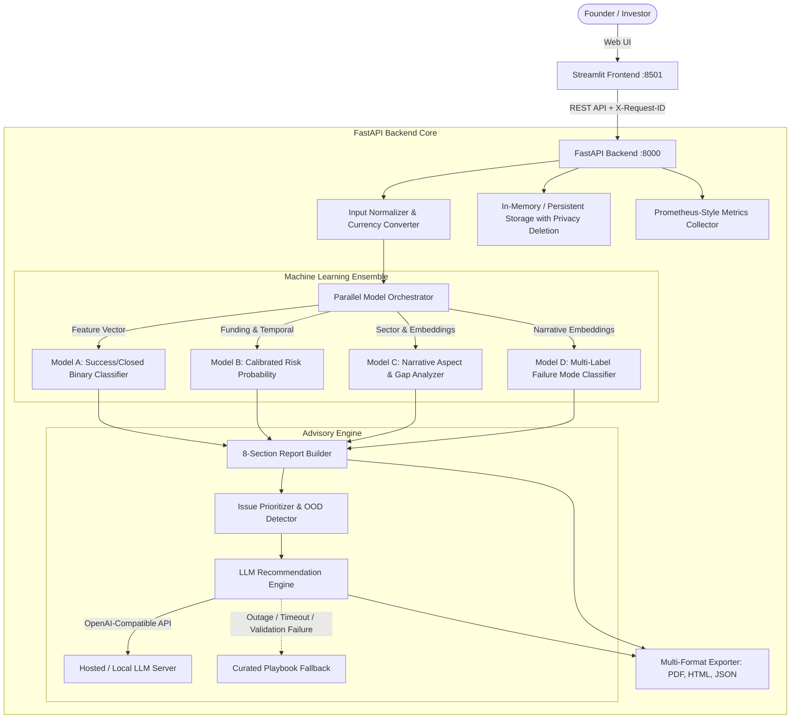

# Multi-Model Startup Risk & Failure Advisory Platform

An enterprise-grade, multi-model machine learning and LLM advisory platform for startup risk assessment, failure pattern classification, and grounded strategic recommendations.

The system combines four specialized, offline-trained machine learning models with a deterministic normalization pipeline, an automated risk prioritizer, and a constrained LLM advisory engine with automatic template fallback.

---

## 🏛 System Architecture



---

## 🚀 Key Features

1. **Four Offline-Trained Machine Learning Models:**
   - **Model A (Binary Classification):** Predicts Operating vs. Closed status using structured numerical and categorical startup features.
   - **Model B (Calibrated Risk Probability):** Estimates risk of failure with Platt/Isotonic calibration and temporal drift warnings.
   - **Model C (Narrative Aspect Analyzer):** Analyzes pitch deck narrative embeddings against historical startup sectors, identifying qualitative strengths, weaknesses, and informational gaps.
   - **Model D (Multi-Label Failure Classifier):** Categorizes startup risk into specific historical failure modes (e.g., *Cash Flow Runaway*, *Product-Market Fit Disconnect*, *Regulatory Friction*).
   - **Strict Isolation:** Fully offline inference with no external model downloads or weight fetches at runtime.

2. **Deterministic Issue Prioritization:**
   - Aggregates quantitative signals and narrative findings into `High`, `Medium`, and `Low` priority issues.
   - Explicit Out-of-Distribution (OOD) detection automatically caps confidence and priority when input pitches diverge from training cohorts.

3. **Grounded LLM Advisory with Guaranteed Fallback:**
   - Produces structured recommendations strictly grounded in model evidence quotes and curated playbooks.
   - Zero hardcoded model names: connects dynamically via standard OpenAI-compatible API specifications (e.g., Groq, vLLM, Ollama, Llama.cpp).
   - Automated schema validation and quote grounding checks with automatic single-repair attempt.
   - Seamless fallback to deterministic, curated playbook templates on network timeout, API outage, or schema invalidity.

4. **Iterative Clarification & Lineage:**
   - Generates targeted clarifying questions on missing aspects.
   - Submitting clarification answers generates a linked revision (`v1`, `v2`, etc.) with lineage tracking.

5. **Security, Privacy & Compliance:**
   - **GDPR-compliant Right to Erasure:** `DELETE /v1/evaluations/{id}` purges evaluation records, reports, recommendations, and cached outputs.
   - **Log Redaction:** All startup pitch text and confidential business inputs are redacted from application logs.
   - **Consent Gate:** Explicit user consent requirement prior to dispatching pitch narratives to external LLMs.
   - **Prompt Injection Defense:** Strict tag-isolated prompt structure prevents prompt injection attacks from overriding system guidelines.

6. **Full-Format Reporting & Export:**
   - Interactive Streamlit dashboard with risk visualizations, trust metrics, and comparison tabs.
   - One-click export to self-contained **HTML**, structured **JSON**, and publication-ready **PDF** (via ReportLab).

---

## 📁 Repository Structure

```
ML_project/
├── backend/
│   ├── adapters/               # Model adapter implementations (Model A, B, C, D)
│   ├── normalization/          # Currency conversion, sector mapping, payload building
│   ├── recommendations/        # Issue prioritizer, LLM client, validators, playbook
│   ├── schemas/                # Pydantic v2 data models (submissions, reports, envelopes)
│   ├── config.py               # Central environment configuration
│   ├── exporter.py             # PDF, HTML, and JSON report generation
│   ├── main.py                 # FastAPI application routes and middleware
│   ├── metrics.py              # Thread-safe observability metrics tracker
│   ├── orchestrator.py         # Parallel thread pool model execution
│   ├── registry.py             # Model lifecycle manager
│   ├── report_builder.py       # 8-section synthesis engine
│   └── storage.py              # In-memory thread-safe evaluation storage
├── frontend/
│   ├── pages/                  # Streamlit view pages (Landing, Form, Review, Report)
│   ├── api_client.py           # Backend communication client
│   ├── app.py                  # Streamlit entry point
│   ├── config.py               # Frontend environment settings
│   └── ui_helpers.py           # Styling cards, risk banners, and layout helpers
├── models/                     # Offline model weights, scalers, and inference scripts
│   ├── model_a/v1/
│   ├── model_b/v1/
│   ├── model_c/v1/
│   └── model_d/v1/
├── tests/                      # Pytest verification suites (56 test cases)
│   ├── test_backend_api.py
│   ├── test_failure_injection.py
│   ├── test_frontend_flow.py
│   ├── test_golden_set.py
│   ├── test_issue_prioritizer.py
│   ├── test_llm_recommendations.py
│   ├── test_load.py
│   ├── test_model_adapters.py
│   ├── test_model_smoke.py
│   └── test_normalization.py
├── scripts/
│   └── verify_prelaunch_checklist.py  # 8-point pre-launch compliance audit script
├── Dockerfile.backend          # Production FastAPI container
├── Dockerfile.frontend         # Production Streamlit container
├── docker-compose.yml          # Multi-container orchestration
├── requirements.txt            # Frozen production Python dependencies
└── pyproject.toml              # Environment and type-checking configuration
```

---

## 🛠 Local Setup & Installation

### Prerequisites
- Python 3.11+
- Virtual environment tool (`venv` or `uv`)

### 1. Clone & Setup Environment

```bash
cd ML_project

# Create and activate virtual environment
python3 -m venv .venv
source .venv/bin/activate

# Install dependencies
pip install -r requirements.txt
```

### 2. Configure Environment Variables

Create or update a `.env` file in the project root:

```env
# Server Configuration
BACKEND_HOST=0.0.0.0
BACKEND_PORT=8000
FRONTEND_PORT=8501
BACKEND_API_URL=http://localhost:8000

# LLM Configuration (OpenAI-compatible)
ENABLE_LLM=true
LLM_API_BASE=https://api.groq.com/openai/v1
LLM_API_KEY=your_api_key_here
LLM_MODEL=your-preferred-model-name
LLM_TIMEOUT_SECONDS=45
LLM_TEMPERATURE=0.2

# Operational Budgets
MODEL_TIMEOUT_SECONDS=10.0
MAX_TEXT_LENGTH=4000
```

---

## 🏃 Running the Application

### Option A: Local Development

Run the backend and frontend in separate terminals:

**Terminal 1 (Backend):**
```bash
source .venv/bin/activate
uvicorn backend.main:app --host 0.0.0.0 --port 8000 --reload
```

**Terminal 2 (Frontend):**
```bash
source .venv/bin/activate
streamlit run frontend/app.py --server.port 8501
```

Access the UI at: `http://localhost:8501`  
Access API Documentation at: `http://localhost:8000/docs`

---

### Option B: Docker Compose (Production Containers)

Run the entire platform inside isolated Docker containers:

```bash
docker-compose up --build
```

- Frontend: `http://localhost:8501`
- Backend API: `http://localhost:8000`
- Prometheus Metrics: `http://localhost:8000/v1/meta/metrics`

---

## 🧪 Testing & Quality Assurance

The platform includes an exhaustive 56-test test suite covering functional logic, schema consistency, failure injection, concurrent load, and edge cases.

### Run All Tests

```bash
pytest tests/ -v
```

### Run Failure Injection & Resilience Tests

```bash
pytest tests/test_failure_injection.py -v
```
- Tests model runtime crash isolation.
- Tests LLM API outage and immediate fallback to curated playbooks.
- Tests pitch text character boundary constraints (>4000 characters).
- Tests user consent gating for external LLM calls.
- Tests prompt injection isolation.

### Run Concurrent Load Tests

```bash
pytest tests/test_load.py -v
```
- Simulates 8 concurrent evaluation requests across thread pools to ensure zero state leakage and sub-second average response latencies.

### Run Pre-Launch Checklist Audit

```bash
python scripts/verify_prelaunch_checklist.py
```
Audits all 8 mandatory launch criteria defined in Section 10 of the specification:
1. `[PASS]` Model outputs contain meaning text, warnings, and validation status.
2. `[PASS]` No screen shows a combined score or 'chance of failure in N years'.
3. `[PASS]` Blank optional fields never appear as weaknesses.
4. `[PASS]` Not-applicable and unavailable states render cleanly.
5. `[PASS]` Recommendation engine passes grounding and validator checks with playbook fallback.
6. `[PASS]` Zero runtime downloads of models or weights.
7. `[PASS]` Raw user text is redacted from logs, and deletion purges data completely.
8. `[PASS]` Production library versions match training environments.

---

## 📊 Observability & Metrics

The backend exposes real-time operational metrics at `GET /v1/meta/metrics`:

```json
{
  "total_requests": 142,
  "successful_evaluations": 139,
  "failed_evaluations": 0,
  "deleted_evaluations": 3,
  "recommendation_methods": {
    "llm_grounded": 124,
    "template_playbook": 15
  },
  "ood_flagged_count": 8,
  "average_model_latency_ms": {
    "model_a": 1.4,
    "model_b": 2.1,
    "model_c": 14.8,
    "model_d": 11.2
  }
}
```

Every incoming request is tagged with an `X-Request-ID` and latency header (`X-Process-Time`) for distributed tracing and performance auditing.

---

## 📄 License & Attribution

Internal Development & Proprietary Advisory Platform. Built for startup evaluation and risk analysis.
